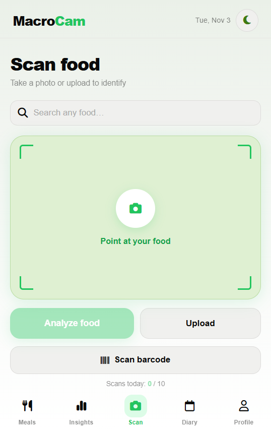
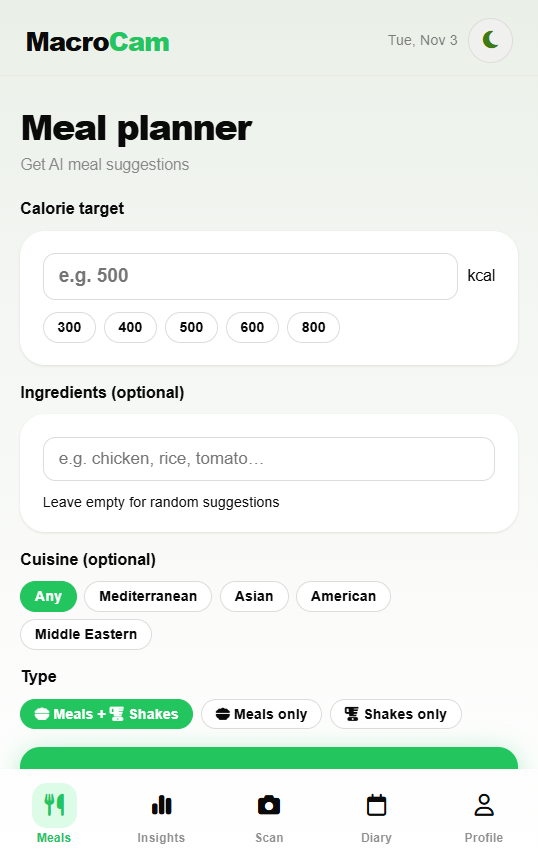

<h1 align="center">MacroCam</h1>

<p align="center">
  <b>Point your camera at any food and get calories, macros and micronutrients in seconds.</b><br>
  An AI-powered food scanner and nutrition tracker, built as an installable Progressive Web App.
</p>

<p align="center">
  <a href="https://macrocam.netlify.app"></a>
</p>

<p align="center">
  
  
  
  
  
  
</p>

<p align="center">
  
  &nbsp;&nbsp;
  
</p>

---

## Highlights

- **41+ users in 10+ countries** since launch.
- **Lighthouse 97 / 95 / 100 / 100** (performance, accessibility, best practices, SEO).
- **Resilient AI calls:** Gemini 2.5 → 2.0 → 1.5 Flash fallback chain, with a countdown when the quota is hit.
- **No exposed keys:** every AI request goes through Netlify serverless functions; keys live only in environment variables.
- **Cheaper requests:** photos are compressed to 512 px before upload, and responses are cached where possible.

## Features

| Area | What it does |
|---|---|
| **Scan** | Photo or gallery upload → Gemini identifies the food and returns full nutrition, including vitamins and minerals. Barcode scanning (native `BarcodeDetector`) pulls packaged products from Open Food Facts. |
| **Search** | Type any food, with live suggestions and Groq-powered lookup. Portion selector with unit conversion (g, kg, oz, lb, cup, tbsp, tsp). |
| **Diary** | Log meals by category with optional price. Animated calorie ring, macro totals, meal search, and confetti when you hit your goal. |
| **Insights** | 7-day calorie chart, macro doughnut, weekly nutrition score, a daily AI tip, and eating-pattern detection (breakfast habits, biggest meal, snacking). |
| **Meal planner** | Set a calorie target, ingredients and cuisine; Groq returns three recipes with exact quantities and steps. |
| **Profile** | Calorie target (Mifflin-St Jeor), protein goal, BMI, ideal weight (Devine), water tracker, logging streak, saved foods, food budget, dark mode. |

## Architecture

```
Browser (PWA: index.html · macrocam.js · style.css · sw.js)
   │  photo / text / barcode
   ├──► /.netlify/functions/gemini   ──► Google Gemini API  (vision, insights)
   ├──► /.netlify/functions/groq     ──► Groq API           (search, meal planner, tips)
   ├──► /.netlify/functions/logmeal  ──► LogMeal API        (meal segmentation, nutrition)
   └──► Open Food Facts API                                  (barcode lookup)
State: localStorage (diary, profile, favourites, water, theme)
```

## Run locally

Prerequisites: Node.js, the [Netlify CLI](https://docs.netlify.com/cli/get-started/), a [Gemini API key](https://aistudio.google.com), a [Groq API key](https://console.groq.com) and, optionally, a [LogMeal](https://logmeal.com) key.

```bash
git clone https://github.com/Lembachar/macrocam.git
cd macrocam
netlify env:set GEMINI_KEY your-gemini-key
netlify env:set GROQ_KEY your-groq-key
netlify env:set LOGMEAL_KEY your-logmeal-key
netlify dev        # serves the app and functions on http://localhost:8888
```

Deploying: push to GitHub, and Netlify builds on every push. Set the same three keys in the Netlify dashboard.

## Install on your phone

- **Android (Chrome):** open [macrocam.netlify.app](https://macrocam.netlify.app) → menu → *Add to Home screen*.
- **iPhone (Safari):** open the site → Share → *Add to Home Screen*.

## Roadmap

- Step and workout tracking with calories burned
- 4-week weight forecast from your daily routine
- Smarter offline mode that caches your most-used foods
- Streak milestones and badges
- Community profiles and progress posts

---

<p align="center"><sub>Built by <a href="https://github.com/Lembachar">Imad Lembachar</a></sub></p>
